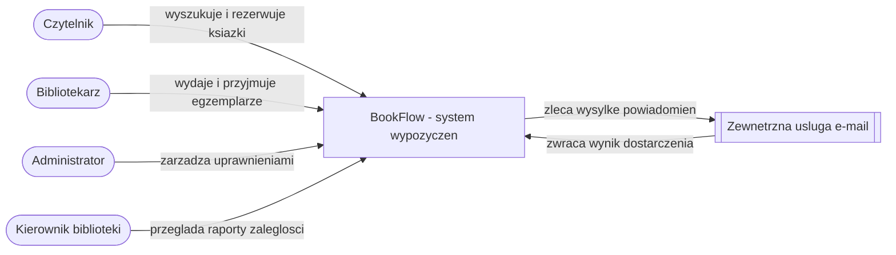
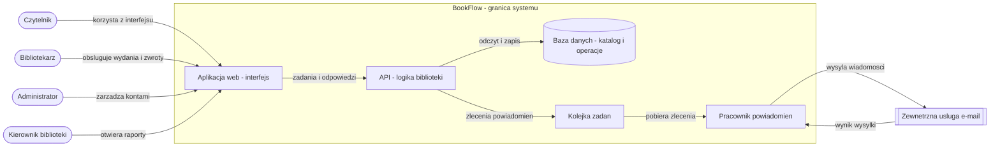
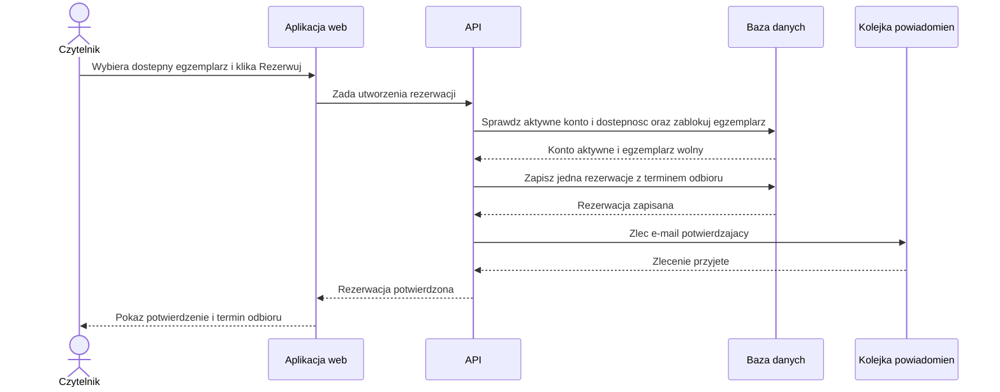
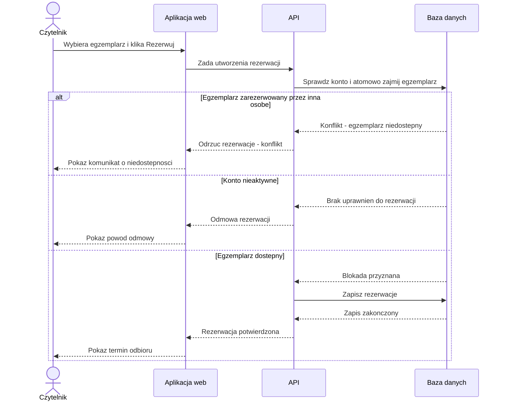
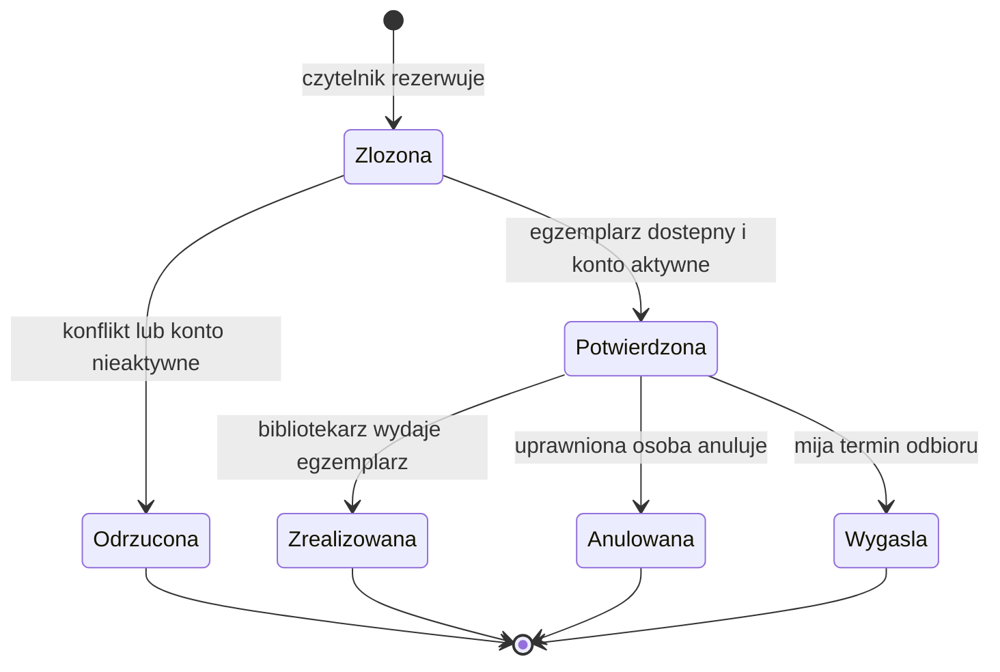

# BookFlow - architektura v0.2

> Modele sa propozycja AI oparta na wymaganiach Lab 1. Nie stanowia zatwierdzonej architektury ani wyboru technologii.

## 1. C4 - poziom 1 - kontekst

**Granica systemu:** BookFlow odpowiada za katalog, rezerwacje, wypozyczenia, zwroty i przygotowanie powiadomien. Dostarczenie e-maila jest poza granica systemu.

## 2. C4 - poziom 2 - kontenery

**Role kontenerow:** aplikacja web wyswietla dane i przyjmuje akcje, API egzekwuje zasady i kontroluje konflikty, baza przechowuje stan, kolejka oddziela wysylke od operacji, pracownik powiadomien kontaktuje sie z usluga e-mail. Nazwy technologii zostana wybrane w Lab 3.

## 3. Diagram sekwencji - rezerwacja dostepnego egzemplarza (R-03, Must)

**Kryterium:** jedna aktywna rezerwacja dla dostepnego egzemplarza i aktywnego czytelnika. Zlecenie e-mail nie jest warunkiem waznosci rezerwacji.

## 4. Diagram sekwencji - konflikt rezerwacji (R-03, Must)

**Kryterium:** przy rownoczesnych probach nie powstaja dwie aktywne rezerwacje tego samego egzemplarza. Niepowodzenie nie tworzy rezerwacji.

## 5. Maszyna stanow - rezerwacja egzemplarza

**Zabronione przejscia:** Zrealizowana -> Potwierdzona oraz Wygasla -> Zrealizowana. Po wydaniu ksiazki cykl rezerwacji sie konczy, a dalsza obsluga dotyczy wypozyczenia.

## 6. Trzy zalozenia AI
1. Czytelnik ma aktywne konto przed utworzeniem rezerwacji (zgodne z R-03).
2. Zapis rezerwacji i kontrola konfliktu sa jedna operacja atomowa (wniosek z NF-06).
3. Powiadomienia sa zlecane asynchronicznie, aby awaria e-mail nie anulowala rezerwacji (zgodne z granica Lab 1).

## 7. Trzy pytania bez odpowiedzi w wymaganiach
1. Jaki jest ostateczny termin odbioru rezerwacji i kto moze go zmieniac?
2. Czy anulowanie przez bibliotekarza wymaga podania powodu?
3. Jak dokladnie przydzielac zwrocony egzemplarz osobom w kolejce na tytul?

## 8. Weryfikacja diagramow
- Aktorzy z Lab 1: czytelnik, bibliotekarz, administrator, kierownik - uwzglednieni.
- Usluga e-mail jest oznaczona jako zewnetrzna.
- Strzalki maja opisy czynnosci lub danych.
- Sciezka glowna i blad rezerwacji odpowiadaja R-03 i NF-06.
- Diagramy sa na poziomie systemu i kontenerow - bez klas i tabel.
- Skladnia Mermaid wymaga sprawdzenia w podgladzie GitHub lub mermaid.live.
